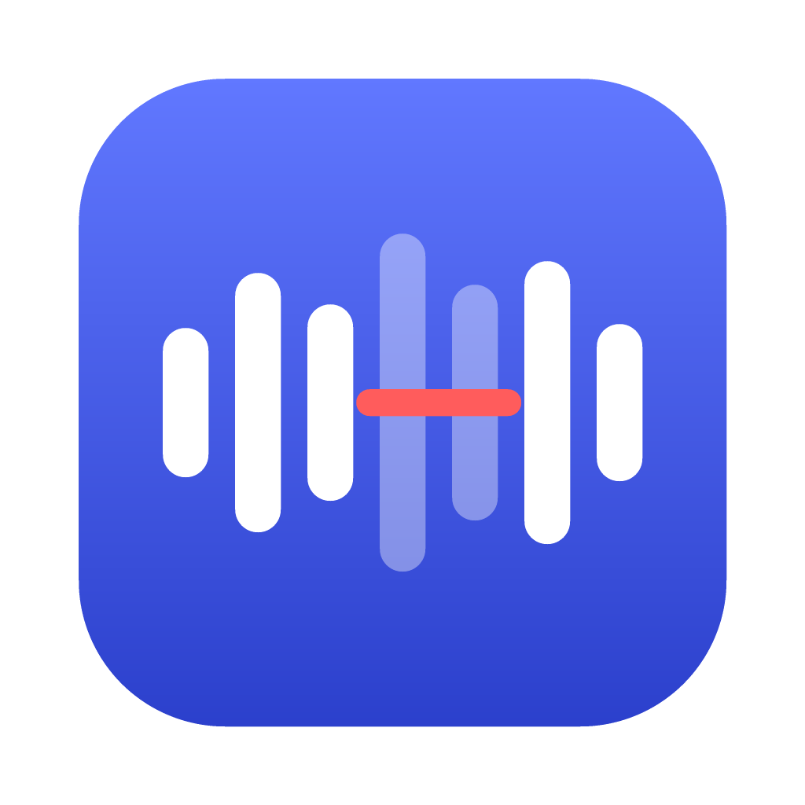
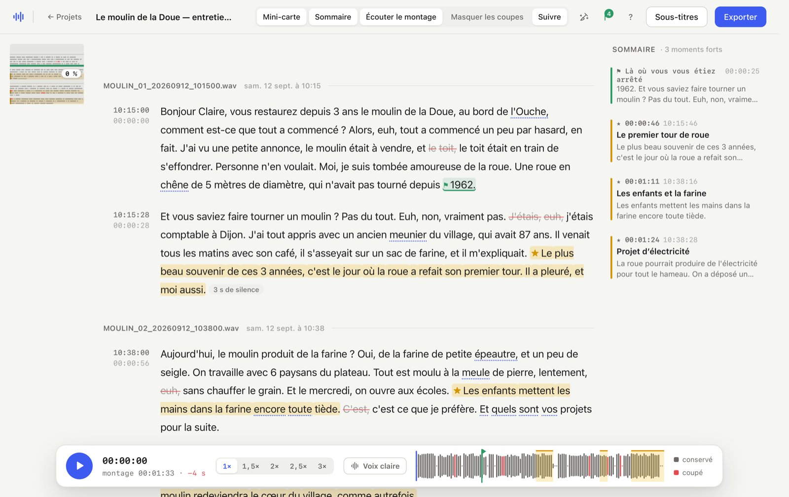
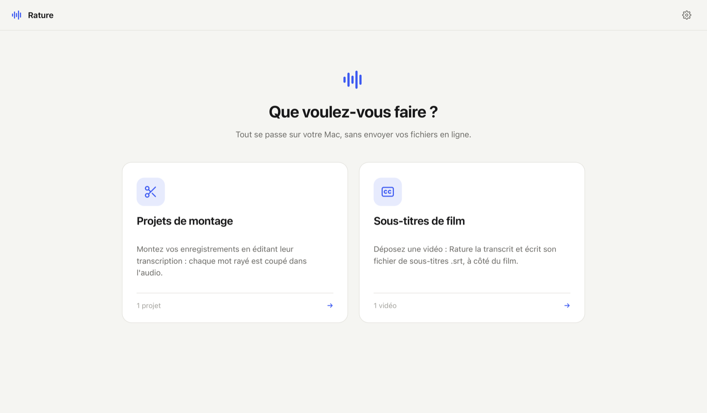
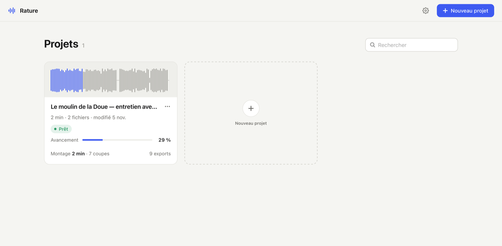
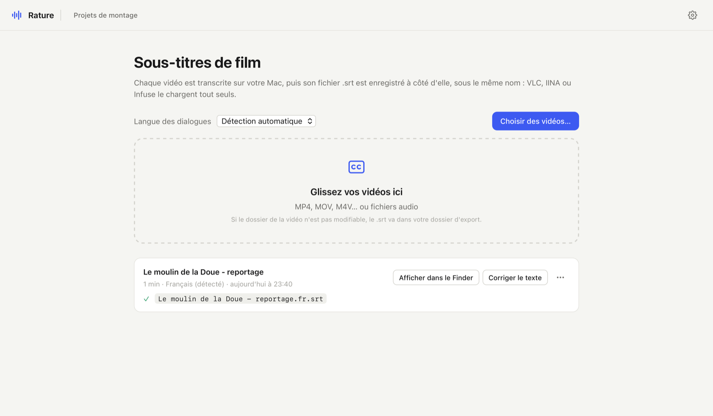

<p align="center">
  
</p>

<h1 align="center">Rature</h1>

<p align="center">
  <b>Montez vos enregistrements en éditant leur transcription. Sous-titrez vos vidéos en un glisser-déposer.</b><br>
  Gratuit, open source, et 100&nbsp;% sur votre Mac : votre son ne quitte jamais votre ordinateur.
</p>

<p align="center">
  <a href="https://github.com/kirea-sas/rature/releases/latest"><b>⬇︎ Télécharger pour Mac</b></a> ·
  <a href="README.md">English version</a> ·
  <a href="#compiler-depuis-les-sources">Compiler depuis les sources</a>
</p>

<p align="center">
  
</p>

---

## Rature, c'est quoi ?

Rature transforme des heures d'enregistrement en un texte qui se modifie comme un document :

- **Rayez un mot, il disparaît du son.** Sélectionnez un passage, appuyez sur <kbd>⌫</kbd> : la coupe se fait sur le silence le plus proche. <kbd>⌘Z</kbd> la défait.
- **Déposez une vidéo, récupérez ses sous-titres.** Rature la transcrit et enregistre un fichier `.srt` juste à côté du film, sous le même nom : VLC, IINA ou Infuse le chargent tout seuls.

Tout tourne en local avec [whisper.cpp](https://github.com/ggml-org/whisper.cpp) sur Apple Silicon (Metal). Ni compte, ni abonnement, ni envoi en ligne.

<p align="center">
  
</p>

## Deux usages

### ✂️ Projets de montage : monter le son comme un document

Importez interviews, podcasts, prises de son (plusieurs fichiers sont mis bout à bout dans l'ordre d'enregistrement) : Rature en tire une transcription mot à mot, synchronisée avec le son.

- **Couper en rayant le texte** : sélection, puis <kbd>⌫</kbd> ; ou les ciseaux ✂︎ d'un paragraphe pour le supprimer d'un coup (ceux du paragraphe suivant arrivent sous la souris : on enchaîne sans bouger).
- **Écouter le montage** de 1× à 3×, les coupes sautées sans à-coup, avec un mode **Voix claire** pour les salles bruyantes.
- **Corriger la transcription** : double-clic sur un mot ; Rature propose de corriger aussi les autres occurrences.
- **Se repérer dans des heures de son** : mini-carte, repère « là où vous vous étiez arrêté » remis tout seul, moments forts avec une note, sommaire, et l'avancement de chaque projet sur l'accueil.
- **Nettoyer en un clic** les longs silences et les hésitations (*euh*, *hum*…).
- **Exporter** en MP3, M4A ou WAV, avec amélioration de la voix en option (réduction du bruit, égaliseur, nivellement, volume calé pour le podcast ou la radio), plus le texte, les sous-titres SRT, la liste des coupes (CSV) et les moments forts. Les exports tournent en arrière-plan pendant que vous continuez.

<p align="center">
  
</p>

### 🎬 Sous-titres de film : une vidéo en entrée, un `.srt` en sortie

<p align="center">
  
</p>

1. Glissez une ou plusieurs vidéos (ou tout un dossier) sur la fenêtre.
2. Choisissez la langue des dialogues, ou laissez Rature la détecter.
3. C'est tout : `Mon film.fr.srt` apparaît à côté de `Mon film.mp4` dès la fin de la transcription.

Les sous-titres sont mis en forme pour l'écran : deux lignes d'environ 42 caractères au plus, jamais affichés plus longtemps que le temps de lecture, sans chevauchement (acceptés par YouTube et les logiciels de montage). Un nom propre à corriger ? **Corriger le texte** ouvre la transcription dans l'éditeur ; le bouton **Sous-titres** réécrit le même fichier.

Fonctionne avec **MP4, MOV, M4V** et tout fichier audio que macOS sait lire. Les **MKV, AVI, WebM…** passent par FFmpeg (voir [Formats](#formats)). Quand il y a plusieurs pistes audio, Rature prend celle de la langue choisie.

## Télécharger et installer

1. Téléchargez **`Rature-x.y.z.dmg`** depuis la [dernière version](https://github.com/kirea-sas/rature/releases/latest).
2. Ouvrez-le et glissez **Rature** dans **Applications**.
3. **Premier lancement :** l'app n'est pas encore notarisée par Apple, macOS peut donc la bloquer. Clic droit sur Rature dans Applications → **Ouvrir** → **Ouvrir**. (Ou : Réglages Système → Confidentialité et sécurité → *Ouvrir quand même*.) Une seule fois suffit.
4. À la première utilisation, Rature télécharge son modèle de reconnaissance vocale (Whisper *large-v3-turbo*, environ 1,6&nbsp;Go). Ensuite, il fonctionne hors ligne.

**Configuration :** un Mac Apple Silicon (M1 ou plus récent), macOS 14 Sonoma ou plus récent, environ 3&nbsp;Go libres pour le modèle. 16&nbsp;Go de mémoire sont confortables pour les longs enregistrements.

**Vitesse :** sur un Mac M, un épisode de 45 minutes est transcrit en 2 à 3 minutes environ.

## Modèles de transcription

| Modèle | Taille | Pour |
|---|---|---|
| Whisper large-v3-turbo *(par défaut)* | 1,6 Go | Rapide et précis, une centaine de langues |
| Whisper large-v3-turbo compact | 0,6 Go | Presque aussi bon, trois fois plus léger |
| Whisper large-v3 | 3,1 Go | Un peu plus précis, plus lent |
| Whisper small | 0,5 Go | Petits Mac, brouillons rapides |
| Cohere Transcribe *(facultatif)* | 2,4 Go | Texte très juste dans 14 langues ; Whisper place toujours les mots dans le temps |

Changez de modèle dans les **Réglages** (<kbd>⌘,</kbd>). Les modèles se téléchargent à la demande et peuvent être rangés sur un autre disque.

## Formats

| | Lecture | Remarques |
|---|---|---|
| WAV, BWF, AIFF, CAF, FLAC, MP3, M4A, AAC, ALAC | ✅ | Lus directement par macOS |
| MP4, MOV, M4V (caméras, téléphones, GoPro…) | ✅ | Son lu dans la vidéo, sans copie |
| MKV, AVI, WebM, WMV, TS… | ✅ avec FFmpeg | Les versions qui embarquent FFmpeg les lisent d'office ; sinon Rature utilise FFmpeg s'il est installé (`brew install ffmpeg`) |

## Confidentialité

- Les fichiers audio et vidéo ne sont **jamais envoyés en ligne** : transcription, montage et export se font sur votre Mac.
- Rature ne se connecte que pour télécharger un modèle que vous avez demandé et, si l'option reste active, pour vérifier une fois par jour s'il existe une nouvelle version (la dernière release de ce dépôt GitHub). Vous pouvez la désactiver dans les Réglages.
- Les projets sont de simples dossiers (JSON et audio) dans `~/Rature/Projets`, que vous pouvez déplacer où vous voulez.

## Raccourcis clavier

| Touche | Action |
|---|---|
| <kbd>Espace</kbd> | Lecture / pause |
| <kbd>⌫</kbd> | Couper les mots sélectionnés |
| <kbd>R</kbd> | Restaurer les mots sélectionnés |
| <kbd>F</kbd> | Marquer un moment fort |
| <kbd>⌘Z</kbd> / <kbd>⇧⌘Z</kbd> | Annuler / rétablir |
| <kbd>←</kbd> <kbd>→</kbd> | Reculer / avancer de 5 s |
| <kbd><</kbd> <kbd>></kbd> | Ralentir / accélérer (1× à 3×) |
| <kbd>⌘,</kbd> | Réglages |
| <kbd>?</kbd> | Tous les raccourcis |

## Compiler depuis les sources

Il faut les outils en ligne de commande de Xcode (`xcode-select --install`), [uv](https://docs.astral.sh/uv/) et CMake.

```bash
git clone https://github.com/kirea-sas/rature.git
cd rature/source
./construire.sh              # construit Rature.app et l'installe dans /Applications
./construire.sh --sans-installer   # …ou la laisse dans ../build/dist
```

Le script télécharge et vérifie (SHA-256) ses dépendances, puis assemble une app autonome : Python 3.13, whisper.cpp (Metal), LAME, RNNoise et une version audio seule, LGPL, de FFmpeg (`RATURE_SANS_FFMPEG=1` pour s'en passer). Il produit aussi un `.dmg`. Pour signer et notariser avec un compte Apple Developer, définissez `RATURE_IDENTITE` et `RATURE_NOTAIRE` (voir le haut du script).

Pour lancer le serveur sans la fenêtre de l'app (après une première construction, qui crée l'environnement Python) : `../build/venv/bin/python rature.py`, puis ouvrez l'adresse affichée dans un navigateur.

### Comment c'est fait

- `source/rature.py` : serveur HTTP local et moteur de traitement (import, transcription Whisper par blocs de 10 minutes sans jamais chevaucher deux fichiers, blocs ratés refaits, alignement des mots, points de coupe calés sur les creux d'énergie, export et sous-titres).
- `source/web/` : l'interface (HTML/CSS/JS sans framework, en français et en anglais).
- `source/mac.py` : la fenêtre native (pywebview / WKWebView), les menus, les dialogues de fichiers, le glisser-déposer.
- `source/traitement.py` : amélioration de la voix et volume des exports.
- `source/alignement.py`, `source/cohere_worker.py` : la passe Cohere facultative, alignée sur les temps de Whisper.
- `demo/` : un projet de démonstration fictif et les scripts des captures d'écran et du test de non-régression de l'éditeur.

## Contribuer

Les tickets et les pull requests sont les bienvenus. Pour un bug, joignez si possible le journal `~/Library/Logs/Rature.log`. L'interface existe en français et en anglais ; les textes sont dans `source/web/i18n.js`.

## Crédits et licence

Rature est publié sous [licence MIT](LICENSE). Il s'appuie sur whisper.cpp et ggml (MIT), les modèles Whisper d'OpenAI (MIT), LAME (LGPL), RNNoise (BSD), FFmpeg (LGPL, version audio seule), pywebview (BSD), NumPy (BSD) et Python (PSF). La liste complète, avec le texte des licences, est dans l'app : **Rature → Licences open source**.

Une réalisation de [Kirea](https://www.kirea.fr).
