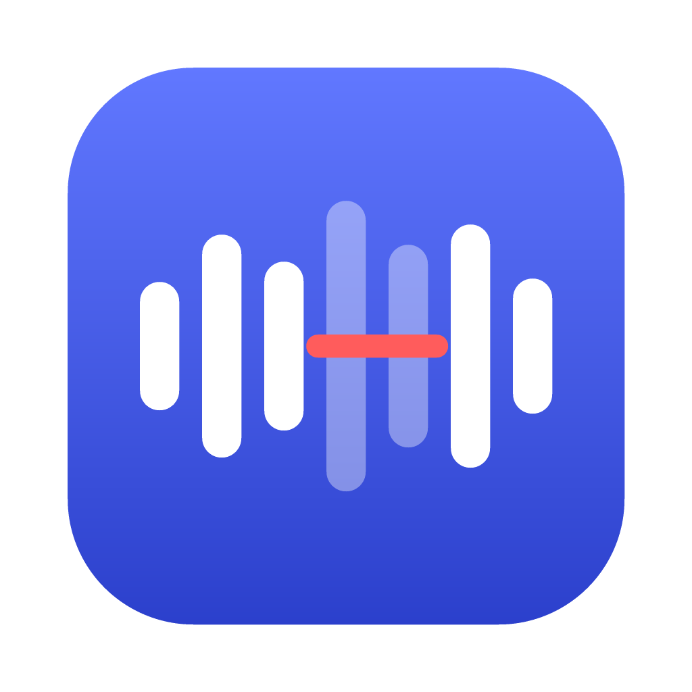
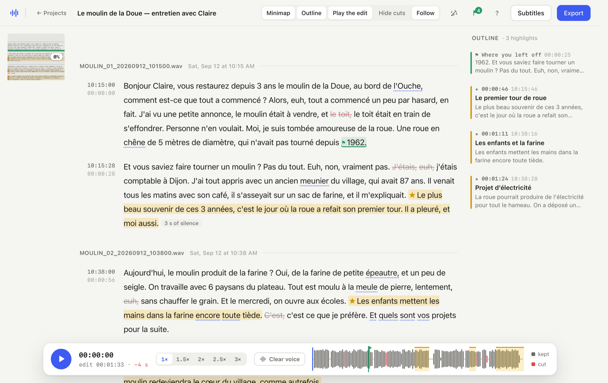
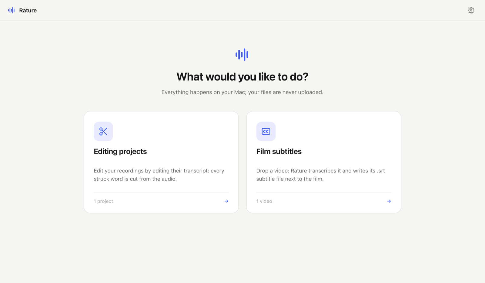
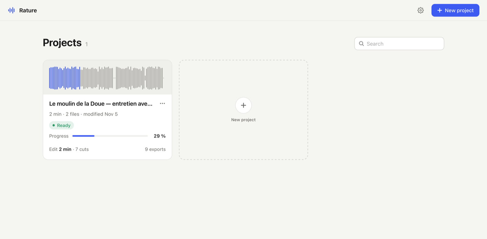
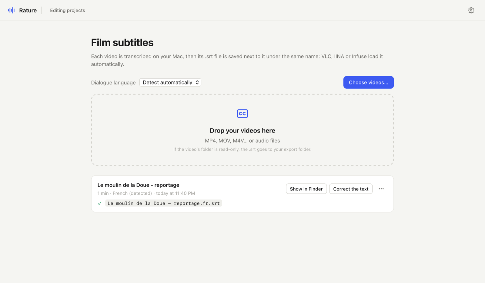

<p align="center">
  
</p>

<h1 align="center">Rature</h1>

<p align="center">
  <b>Edit your recordings by editing their transcript. Subtitle your videos in one drop.</b><br>
  Free, open source, and 100&nbsp;% on your Mac — your audio never leaves your computer.
</p>

<p align="center">
  <a href="https://github.com/kirea-sas/rature/releases/latest"><b>⬇︎ Download for Mac</b></a> ·
  <a href="README.fr.md">Version française</a> ·
  <a href="#build-from-source">Build from source</a>
</p>

<p align="center">
  
</p>

---

## What is Rature?

Rature (French for *crossing-out*) turns hours of recordings into text you can edit like a document:

- **Strike out a word, it disappears from the audio.** Select a passage, press <kbd>⌫</kbd>, and the cut is made on the nearest silence. <kbd>⌘Z</kbd> brings it back.
- **Drop a video, get its subtitles.** Rature transcribes it and saves a `.srt` file right next to the film, with the same name — VLC, IINA or Infuse load it on their own.

Everything runs locally with [whisper.cpp](https://github.com/ggml-org/whisper.cpp) on Apple Silicon (Metal). No account, no subscription, no upload.

<p align="center">
  
</p>

## Two ways to use it

### ✂️ Editing projects — edit audio like a document

Import interviews, podcasts, field recordings (several files are joined in order of recording time), and Rature gives you a word-by-word transcript synchronised with the sound.

- **Cut by striking text** — select, <kbd>⌫</kbd>; or the ✂︎ next to a paragraph to drop it whole (the next paragraph's scissors land under your mouse, so you can chain them).
- **Listen to the edit** at 1× to 3×, skipping the cuts seamlessly, with an optional **Clear voice** mode for noisy rooms.
- **Fix the transcript** — double-click a word; Rature offers to fix every other occurrence.
- **Find your way in hours of audio** — minimap, *where you left off* marker restored automatically, highlights with short notes, an outline, and a progress bar per project on the home page.
- **Clean up in one click** — long silences and hesitations (*euh*, *um*…) are detected for you.
- **Export** MP3, M4A or WAV, with optional speech enhancement (noise reduction, voice EQ, levelling, loudness normalisation for podcast or radio), plus the transcript, SRT subtitles, cut list (CSV) and highlights. Exports run in the background while you keep working.

<p align="center">
  
</p>

### 🎬 Film subtitles — one video in, one `.srt` out

<p align="center">
  
</p>

1. Drop one or more videos (or a whole folder) on the window.
2. Choose the dialogue language, or let Rature detect it.
3. That's it: `My film.en.srt` appears next to `My film.mp4` as soon as the transcription ends.

Subtitles are laid out for the screen (two lines of ~42 characters at most, never on screen longer than it takes to read them, no overlaps — accepted by YouTube and video editors). Need to fix a name? **Correct the text** opens the transcript in the editor; **Subtitles** rewrites the same file.

Works with **MP4, MOV, M4V** and any audio file macOS can read. **MKV, AVI, WebM…** are read through FFmpeg (see [Formats](#formats)). With several audio tracks, Rature picks the one in the language you chose.

## Download & install

1. Download **`Rature-x.y.z.dmg`** from the [latest release](https://github.com/kirea-sas/rature/releases/latest).
2. Open it and drag **Rature** into **Applications**.
3. **First launch:** the app is not notarised by Apple yet, so macOS may block it. Right-click Rature in Applications → **Open** → **Open**. (Or: System Settings → Privacy & Security → *Open Anyway*.) You only do this once.
4. On first use, Rature downloads its speech-recognition model (Whisper *large-v3-turbo*, about 1.6&nbsp;GB). After that, it works offline.

**Requirements:** a Mac with Apple Silicon (M1 or later), macOS 14 Sonoma or later, ~3&nbsp;GB of free space for the model. 16&nbsp;GB of RAM is comfortable for long recordings.

**Speed:** on an M-series Mac, a 45-minute episode is transcribed in about 2–3 minutes.

## Transcription models

| Model | Size | Best for |
|---|---|---|
| Whisper large-v3-turbo *(default)* | 1.6 GB | Fast and accurate in ~100 languages |
| Whisper large-v3-turbo compact | 0.6 GB | Almost as good, a third of the size |
| Whisper large-v3 | 3.1 GB | Slightly more accurate, slower |
| Whisper small | 0.5 GB | Small Macs, quick drafts |
| Cohere Transcribe *(optional)* | 2.4 GB | Very accurate text in 14 languages; Whisper still places the words in time |

Switch models in **Settings** (<kbd>⌘,</kbd>). Models are downloaded on demand and can be moved to another disk.

## Formats

| | Read | Notes |
|---|---|---|
| WAV, BWF, AIFF, CAF, FLAC, MP3, M4A, AAC, ALAC | ✅ | Read directly by macOS |
| MP4, MOV, M4V (cameras, phones, GoPro…) | ✅ | Sound read straight from the video, no copy |
| MKV, AVI, WebM, WMV, TS… | ✅ with FFmpeg | Release builds that embed FFmpeg read them out of the box; otherwise Rature uses FFmpeg if it's installed (`brew install ffmpeg`) |

## Privacy

- Audio and video files are **never uploaded**: transcription, editing and export all happen on your Mac.
- Rature only goes online to download a model you asked for, and — if you leave it on — to check once a day for a new version (the latest release of this GitHub repository). You can turn that off in Settings.
- Projects are plain folders (JSON + audio) in `~/Rature/Projets`, which you can move anywhere.

## Keyboard shortcuts

| Key | Action |
|---|---|
| <kbd>Space</kbd> | Play / pause |
| <kbd>⌫</kbd> | Cut the selected words |
| <kbd>R</kbd> | Restore the selected words |
| <kbd>F</kbd> | Mark as highlight |
| <kbd>⌘Z</kbd> / <kbd>⇧⌘Z</kbd> | Undo / redo |
| <kbd>←</kbd> <kbd>→</kbd> | Back / forward 5 s |
| <kbd><</kbd> <kbd>></kbd> | Slower / faster (1× to 3×) |
| <kbd>⌘,</kbd> | Settings |
| <kbd>?</kbd> | All shortcuts |

## Build from source

You need Xcode Command Line Tools (`xcode-select --install`), [uv](https://docs.astral.sh/uv/) and CMake.

```bash
git clone https://github.com/kirea-sas/rature.git
cd rature/source
./construire.sh              # builds Rature.app and installs it in /Applications
./construire.sh --sans-installer   # …or leaves it in ../build/dist
```

The script fetches and checks (SHA-256) its dependencies, then builds everything into a self-contained app: Python 3.13, whisper.cpp (Metal), LAME, RNNoise and an audio-only, LGPL build of FFmpeg (`RATURE_SANS_FFMPEG=1` to skip it). It also produces a `.dmg`. To sign and notarise with an Apple Developer account, set `RATURE_IDENTITE` and `RATURE_NOTAIRE` (see the top of the script).

To run the server without the app window (after a first build, which creates the Python environment): `../build/venv/bin/python rature.py`, then open the printed address in a browser.

### How it works

- `source/rature.py` — local HTTP server and processing engine: import, chunked Whisper transcription (10-minute blocks, never across two files, failed blocks retried), word alignment, cut points snapped to energy minima, export and subtitles.
- `source/web/` — the interface (plain HTML/CSS/JS, French and English).
- `source/mac.py` — the native window (pywebview / WKWebView), menus, file dialogs, drag-and-drop.
- `source/traitement.py` — speech enhancement and loudness for exports.
- `source/alignement.py`, `source/cohere_worker.py` — the optional Cohere pass, aligned on Whisper's timings.
- `demo/` — a fictional demo project and the scripts used for the screenshots and the editor regression test.

## Contributing

Issues and pull requests are welcome — bug reports with the log file (`~/Library/Logs/Rature.log`) are especially useful. The interface is in French and English; translations live in `source/web/i18n.js`.

## Credits & licence

Rature is released under the [MIT licence](LICENSE). It builds on whisper.cpp & ggml (MIT), OpenAI Whisper models (MIT), LAME (LGPL), RNNoise (BSD), FFmpeg (LGPL, audio-only build), pywebview (BSD), NumPy (BSD) and Python (PSF). The full list with licence texts is in the app: **Rature → Open source licences**.

Made by [Kirea](https://www.kirea.fr).
